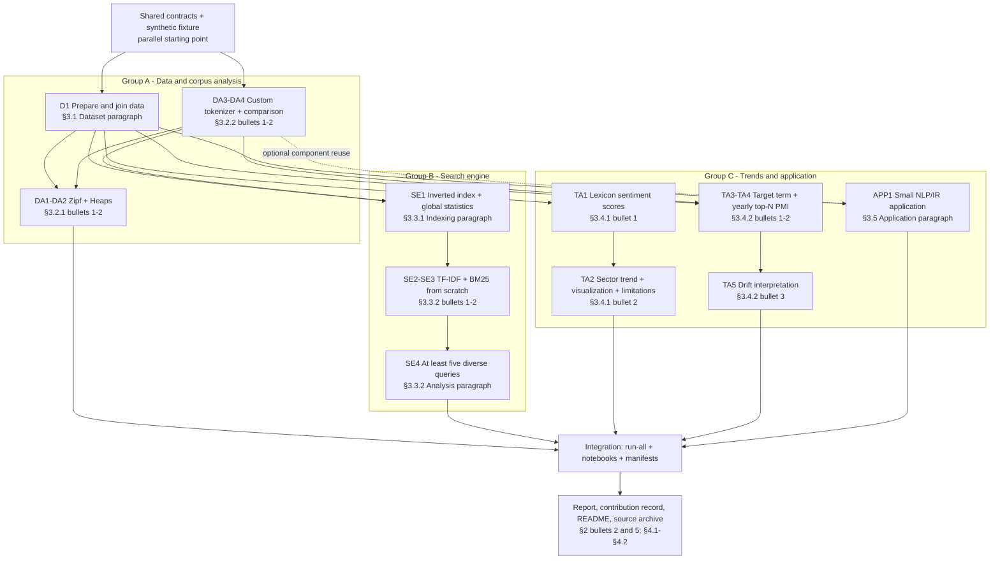

# Six-person team workflow

## Working model

Use three responsibility groups of two people. Each group owns a coherent
assignment area, but the two members work as a pair rather than dividing it into
two isolated personal modules. This gives every area an implementer and a backup,
while still allowing the pair to rebalance work when one task takes longer than
expected.

Do not make the project a relay in which one group must completely finish before
the next group starts. Agree on small interfaces and test fixtures first; all
three groups can then implement against those contracts in parallel.

## Responsibility groups

### Group A: data and corpus analysis (two people)

Owns:

- streaming Yelp JSONL/ZIP input, validation, deterministic sampling, and the
  business-review join (`D1`);
- the shared normalization and tokenizer policy (`DA3`);
- Zipf's law, Heaps' law, and tokenizer-comparison experiments (`DA1`, `DA2`,
  `DA4`);
- `notebooks/00_data_check.ipynb` and `notebooks/01_corpus_analysis.ipynb`;
- CLI registration in `commands/prepare.py` and `commands/analyze.py`.

Suggested internal split: one member leads data preparation and one leads corpus
analysis. Both review the tokenizer because it is a dependency of every group.

### Group B: indexing and retrieval (two people)

Owns:

- the custom inverted index, document statistics, serialization, and loading
  (`SE1`);
- TF-IDF and BM25 scoring from scratch (`SE2`, `SE3`);
- interactive search, at least five batch queries, retrieval evaluation, and
  timing (`SE4`);
- `notebooks/02_search_evaluation.ipynb`;
- CLI registration in `commands/index.py` and `commands/search.py`.

Suggested internal split: one member leads index/storage and one leads ranking and
evaluation. Each must be able to explain the other member's formulas and tests.

### Group C: trends and application (two people)

Owns:

- VADER sentiment scoring and time/category aggregation (`TA1`, `TA2`);
- term co-occurrence, PMI calculation, and temporal drift analysis (`TA3`,
  `TA4`, and `TA5`);
- the comparison-sentence application and its evaluation (`APP1`);
- `notebooks/03_trend_analysis.ipynb` and `notebooks/04_application.ipynb`;
- CLI registration in `commands/trend.py` and `commands/application.py`.

Suggested internal split: one member leads sentiment and one leads PMI/application.
Both review category filtering, date bucketing, and evaluation examples.

## Assignment traceability and dependency flow

The references in this document were checked against the September 2026
assignment brief. The brief numbers sections, but does not number the bullets
inside each section. Therefore, `§3.4.2 bullet 2` means the second visible bullet
under section 3.4.2. Requirements written as prose rather than bullets are named
`Dataset paragraph`, `Indexing paragraph`, `Analysis paragraph`, or
`Application paragraph`. The Work IDs below are project-local shorthand, not
official assignment numbering.

### Dependency flowchart



Solid arrows are hard data or implementation dependencies. The dashed arrow is
optional reuse: the application may reuse the shared tokenizer, but §3.5 allows
another defensible NLP/IR approach. The fixture is deliberately placed before
all three groups so Group B and Group C can develop against stable test records
while Group A is still preparing the real Yelp data.

The critical path is not “Group A finishes, then B, then C.” It is:

1. freeze fixture schemas and tokenizer behavior;
2. develop the three branches in parallel;
3. integrate only their stable artifacts and public interfaces;
4. run the full dataset and finish report evidence.

### Assignment-to-code traceability matrix

| Work ID | Official assignment reference | Required evidence | Owner and main entry point |
| --- | --- | --- | --- |
| `D1` | §3.1, Dataset paragraph | Read `business.json` and `review.json`; documented sample/join and record counts | Group A; `yelptext prepare` |
| `DA1` | §3.2.1, bullet 1 | Term frequencies and log-log frequency-versus-rank Zipf plot | Group A; `yelptext analyze zipf` |
| `DA2` | §3.2.1, bullet 2 | Multiple sample sizes; estimated `k` and `beta`; vocabulary-growth prediction and discussion | Group A; `yelptext analyze heaps` |
| `DA3` | §3.2.2, bullet 1 | Custom regex tokenizer handling emoji, contractions, and run-on/hyphenated words | Group A; shared `text` package |
| `DA4` | §3.2.2, bullet 2 | Vocabulary-size and qualitative comparison with standard tokenizers | Group A; `yelptext analyze tokenizers` |
| `SE1` | §3.3.1, Indexing paragraph | Inverted index, postings, document frequency, document length, and global `avgdl` | Group B; `yelptext index build` |
| `SE2` | §3.3.2, bullet 1 | From-scratch TF-IDF with cosine similarity plus hand-calculated tests | Group B; `yelptext search --ranker tfidf` |
| `SE3` | §3.3.2, bullet 2 | From-scratch BM25 with correct `k1`, `b`, and indexing-time global `avgdl` | Group B; `yelptext search --ranker bm25` |
| `SE4` | §3.3.2, Analysis paragraph | At least five diverse queries run on both rankers, with comparative analysis | Group B; batch search config and notebook 02 |
| `TA1` | §3.4.1, bullet 1 | Review sentiment scores from VADER or another classic lexicon | Group C; `yelptext trend sentiment` |
| `TA2` | §3.4.1, bullet 2 | Sector sentiment by year/season, visualization, and lexicon limitations such as sarcasm | Group C; trend artifacts and notebook 03 |
| `TA3` | §3.4.2, bullet 1 | Explicitly selected target aspect term and documented context definition | Group C; trend configuration |
| `TA4` | §3.4.2, bullet 2 | PMI and top-N co-occurring words for the target in different years | Group C; `yelptext trend pmi` |
| `TA5` | §3.4.2, bullet 3 | Interpretation of how target-term associations drift over time | Group C; notebook 03 and report text |
| `APP1` | §3.5, Application paragraph | Defined and evaluated small NLP/IR tool; CLI is sufficient and GUI adds no marks | Group C; `yelptext app comparisons` and notebook 04 |
| `GOV1` | §2, bullet 2 | Individual contributions clearly identified in the report | All; contribution table in this document |
| `GOV2` | §2, bullet 5 | Members understand submitted code and can defend assumptions/design choices | All; paired ownership, reviews, and decision notes |
| `REP1` | §4.1, bullets 2-3 and 5 | ACM sigconf main content within 10 pages; key snippets and library citations; readable figures/text | Temporary integration group, reviewed by all |
| `SRC1` | §4.2, `Readme.txt` sub-bullets 1-3 | Dependency links, installation/usage commands, inputs/parameters, and sample-output explanations | Temporary integration group |
| `SRC2` | §4.2, `SourceCode` sub-bullet | Source archive contains only own source; excludes dataset and third-party libraries | Temporary integration group |

Every implementation PR should list its Work IDs in the description, for
example `Covers SE1; prepares SE2/SE3`. Every notebook section and report figure
should also name at least one Work ID. This creates a direct chain from assignment
requirement to code, test, artifact, figure, and report discussion.

## Shared contracts agreed before implementation

Freeze the following small contracts during the first checkpoint. Changes are
allowed, but require a short cross-group review because they affect multiple
areas.

### Prepared review record

At minimum, downstream code can rely on:

| Field | Type | Meaning |
| --- | --- | --- |
| `review_id` | `str` | Stable Yelp review identifier |
| `business_id` | `str` | Join key for business metadata |
| `text` | `str` | Original review text |
| `stars` | `float` | Review rating |
| `date` | ISO date/datetime | Review timestamp |
| `categories` | `list[str]` | Normalized business categories |

Group A owns parsing these values. Groups B and C may initially use the fixture
with exactly this schema rather than waiting for full-data preparation.

### Tokenizer contract

The public operation is conceptually:

```python
tokenize(text: str) -> list[str]
```

The same implementation and configuration must be used at index time, query
time, and corpus-analysis time. Its manifest/fingerprint must be saved with a
persisted index so that incompatible indexes cannot silently be queried.

### Index-reader contract

Retrieval code should access postings, document length, corpus document count,
and document frequency through a small public reader interface. It should not
depend on the index builder's private in-memory structures. Group B may refine
the exact class names, but should publish them before other code imports them.

### Artifact contract

Every long-running command writes outputs below `artifacts/` and a manifest that
records configuration, seed, source metadata, tokenizer fingerprint, record
counts, and elapsed time. Notebooks consume these artifacts; they do not rerun
the full dataset automatically.

## Shared fixtures unblock parallel work

The committed artificial fixture under `tests/fixtures/` is the first integration
target before full-data implementation. It contains a small business file and
review file with:

- several businesses and overlapping categories;
- reviews in multiple months or years;
- repeated and rare terms for Zipf/Heaps checks;
- punctuation, emoji, apostrophes, numbers, and mixed case for tokenization;
- positive, neutral, and negative language;
- known co-occurrences around a target such as `service`;
- a few clear comparison sentences and non-comparison controls.

Expected prepared records, a very small index, hand-calculated ranking and PMI
values, and labeled sentiment/comparison cases live under
`tests/fixtures/expected/`. These are invented test data, not a sample copied
from Yelp. The fixture lets Groups B and C start on day one and makes failures
reproducible.

Run fixture smoke tests through the normal CLI by passing
`--config tests/fixtures/fixture.toml`. Do not introduce a second test CLI or
special `--test-data` branches; `pytest` handles unit tests, while the configured
main CLI handles integration tests.

## CLI ownership and merge-conflict policy

There remains one installed command, `yelptext`, but its registration is split by
area:

| File | Primary owner |
| --- | --- |
| `commands/prepare.py`, `commands/analyze.py` | Group A |
| `commands/index.py`, `commands/search.py` | Group B |
| `commands/trend.py`, `commands/application.py` | Group C |
| `commands/run_all.py` | Temporary integration group |
| `commands/_common.py`, `cli.py` | Shared; cross-group review required |

Each command module should only parse arguments and call an importable domain
function. Algorithms and file I/O belong in the domain packages, not in command
handlers. Avoid adding every implementation option to `cli.py`; this would
recreate a high-conflict shared file.

## Review and integration

Use circular cross-group review so each area receives an independent check:

- Group A reviews Group B's formulas, index assumptions, and hand-calculated
  retrieval test;
- Group B reviews Group C's aggregation, PMI formula, and evaluation method;
- Group C reviews Group A's sampling, joins, tokenizer, and corpus statistics.

For integration, temporarily nominate one person from each group. This is a
rotating role, not a fourth permanent team. The three integrators own
`commands/run_all.py`, resolve interface mismatches, reproduce the clean run, and
verify that notebooks read generated artifacts.

## Checkpoints that avoid serial dependency

1. **Contracts and fixtures:** agree on schemas, tokenizer behavior, artifact
   paths, configuration keys, and expected tiny outputs.
2. **Tiny fixture:** every command executes end to end on artificial data and
   unit tests cover hand-computable cases.
3. **Small sample:** run each area independently on a deterministic sample;
   measure time and memory before scaling.
4. **Larger sample:** integrate all artifacts, freeze figure/table schemas, and
   begin report interpretation.
5. **Full data and release:** run `yelptext run-all`, review outputs, execute the
   notebooks from a clean environment, and prepare the source archive.

A group should publish a stub artifact matching its agreed schema when its real
implementation is not ready. Downstream groups can continue against the stub
and later replace it without changing their logic.

## Git and pull-request rules

- Use short feature branches by area, for example `data/tokenizer`,
  `search/bm25`, or `trends/pmi`.
- Keep commits focused; do not combine notebook output churn with algorithm
  changes.
- Rebase or merge `main` frequently and open small pull requests.
- Require one teammate review and one circular cross-group review for shared
  contracts, formulas, or evaluation design.
- Do not commit raw Yelp data, generated large artifacts, secrets, or notebook
  cache/output that is not needed for marking.
- Record important decisions in the pull request and update this document or the
  architecture document when the decision changes a contract.

## Definition of done for a work item

A work item is complete only when it has:

- reusable implementation under `src/yelptext`, not only notebook cells;
- focused unit tests and an artificial-fixture integration test;
- a wired CLI command where applicable;
- deterministic artifact output and manifest metadata;
- a notebook section that presents the result without duplicating algorithms;
- report-ready interpretation or notes, including limitations;
- both group members able to explain and maintain it;
- the required cross-group review for formulas or shared contracts.

## Contribution record

Maintain a simple table in the final report or project log. Record concrete
deliverables and reviews rather than percentages chosen at the end.

| Member | Primary deliverables | Secondary/review work | Evidence (PR/commit/notebook) |
| --- | --- | --- | --- |
| Member 1 |  |  |  |
| Member 2 |  |  |  |
| Member 3 |  |  |  |
| Member 4 |  |  |  |
| Member 5 |  |  |  |
| Member 6 |  |  |  |
