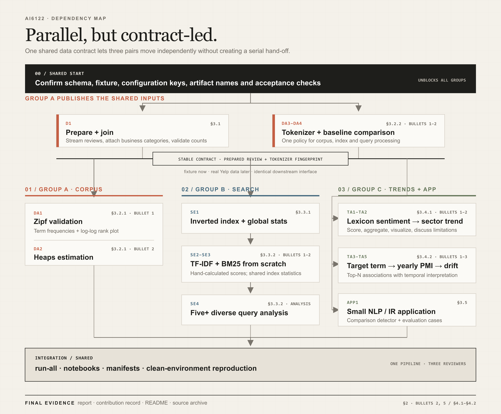

# Six-person team workflow

## Current state

Use three pairs:

- **Group A - data and corpus analysis:** preparation, tokenizer, Zipf, Heaps,
  and tokenizer comparison (§3.1-§3.2).
- **Group B - search:** index, TF-IDF, BM25, queries, and retrieval analysis
  (§3.3).
- **Group C - trends and application:** sentiment, PMI drift, and the small
  NLP/IR application (§3.4-§3.5).

The raw synthetic records exist, but no cross-group schema has been approved.
There are therefore no derived fixtures, fake providers, or expected algorithm
outputs yet. Files under `src/yelptext/contracts/` are proposals for discussion,
not frozen APIs.



## Workflow before parallel implementation

The order is:

1. inspect the Yelp-shaped raw fixture and its edge cases;
2. agree on the minimum schema and Protocol at each group boundary;
3. derive the smallest group-specific inputs from the raw fixture;
4. implement same-interface fake providers;
5. add contract tests and independently checked mathematical oracles;
6. let each group implement its real component against the fake upstream;
7. make the real provider pass the same contract tests;
8. switch provider mode without changing consumer calls;
9. use real samples for empirical tuning and the full data for final evidence.

Do not create derived fixtures before step 2. Otherwise an invented file silently
becomes a schema decision that the team never reviewed.

## What must be confirmed

| Boundary | Owner | Consumers | Decisions required before fixture/fake creation |
| --- | --- | --- | --- |
| Prepared reviews | Group A | A, B, C | fields, Python and serialized types, nullability, date format, category representation, orphan policy, iteration/error behavior |
| Tokenizer | Group A | A, B, optionally C | normalization, contractions, emoji, hyphens, numbers, Unicode, empty input, fingerprint contents |
| Read-only index | Group B | B search/rankers | document identifier, posting fields, position base, global statistics, missing-term behavior, tokenizer compatibility |
| Trend outputs | Group C | notebooks/report | period/category keys, count fields, missing periods, sentiment values, PMI context and filtering |
| Application output | Group C | notebook/report | prediction fields, labels, evidence/cue fields, evaluation record format |

Each boundary must have one example call and one serialized example before it is
approved. Internal helper functions do not require cross-group agreement.

## Provisional contract proposals

The current suggestions are deliberately structural only:

- `src/yelptext/contracts/reviews.py`: proposed `PreparedReview` fields and a
  streaming `ReviewReader`;
- `src/yelptext/contracts/tokenizer.py`: proposed `tokenize()` and
  `fingerprint()` methods;
- `src/yelptext/contracts/index.py`: proposed posting fields and a read-only
  `IndexReader`.

The team may rename fields or change types. Until approval, production modules
must remain placeholders and no fake may claim conformance.

When a proposal is approved, remove its provisional warning and record the
decision in the same pull request that adds its fake, fixture, and contract test.

## Fixture organization after approval

The only committed test data now is:

```text
tests/fixtures/
├── fixture.toml
└── raw/
    ├── businesses.jsonl
    └── reviews.jsonl
```

After contracts are approved, create consumer-oriented directories:

```text
tests/fixtures/
├── raw/
├── group_a/
├── group_b/
└── group_c/
```

Each directory contains only the inputs, labeled cases, and mathematical
oracles needed by that group. A README in the directory must state for every
file:

- which confirmed contract it follows;
- whether it is input, a case-level label, or an exact oracle;
- how it was derived and which edge cases it covers;
- who owns changes to it.

Generated derived input must be reproducible from `raw/`. An expected result for
the algorithm under test must not be produced by that same algorithm. Formula
oracles require hand calculation or an independent reference calculation.

## Fake and real providers

After contract approval, interface owners add same-name implementations in
parallel namespaces:

```text
tests/fakes/
├── reviews.py       # ReviewReader
├── tokenizer.py     # Tokenizer
└── index.py         # IndexReader

src/yelptext/providers/real/
├── reviews.py       # ReviewReader
├── tokenizer.py     # Tokenizer
└── index.py         # IndexReader
```

Both implementations import the one shared contract; a fake must never redefine
the schema. The runtime composition layer selects the namespace:

```toml
[runtime]
mode = "fixture"
```

or:

```toml
[runtime]
mode = "real"
```

Mode selection belongs in the composition root. Domain functions such as
`build_index()` and `search()` must not contain `if fixture` branches or import
`tests.fakes` directly.

The function under test is always real; only its unfinished upstream providers
are fake. For example:

| Work under test | Fake upstream | Real code exercised |
| --- | --- | --- |
| B index builder | A review reader and tokenizer | B `build_index()` |
| B rankers | B read-only index | B TF-IDF/BM25 |
| C trend aggregation | A review reader; tokenizer if required | C aggregation/PMI/sentiment |
| Integrated fixture run | none once real providers exist | the full real pipeline over synthetic data |

Once a real upstream exists, switching mode changes provider construction only.
Consumer imports, function signatures, and calls do not change. A tokenizer
fingerprint change requires rebuilding dependent indexes, not rewriting B code.

## Group A deliverables after its contracts are confirmed

| Area | Production files | Test responsibility |
| --- | --- | --- |
| Raw/prepared data | `data/models.py`, `data/reader.py`, `data/sampler.py`, `data/prepare.py` | fake review reader, join/orphan/sampling tests, approved prepared fixture |
| Tokenization | `text/normalization.py`, `text/tokenizer.py`, `text/baselines.py` | fake tokenizer, confirmed edge cases, fake/real contract test |
| Corpus analysis | `analysis/zipf.py`, `analysis/heaps.py`, `analysis/tokenizer_comparison.py` | exact small-corpus counting/fitting tests; real-sample evidence |
| CLI | `commands/prepare.py`, `commands/analyze.py` | handler tests using injected providers |
| Notebook | `00_dataset_inspection.ipynb`, `01_zipf_heaps_tokenizer.ipynb` | counts, coverage, plots, fitted values, examples, interpretation |

## Group B deliverables after A's fakes are available

| Area | Production files | Test responsibility |
| --- | --- | --- |
| Index model/build | `search/models.py`, `search/index.py` | real builder with fake reviews/tokenizer; compare with independent postings oracle |
| Persistence | `search/storage.py` | round-trip, metadata, corruption, tokenizer mismatch |
| Ranking | `search/rankers/base.py`, `tfidf.py`, `bm25.py` | real rankers with fake index; exact scores and tie/missing-term cases |
| Query/evaluation | `search/query.py`, `search/evaluation.py` | orchestration with fake tokenizer/index; real-sample query analysis |
| CLI | `commands/index.py`, `commands/search.py` | real handler dispatch with injected runtime providers |
| Notebook | `02_search_engine.ipynb` | index statistics, at least five real queries, TF-IDF/BM25 comparison and failures |

Group B owns the approved `IndexReader` contract and publishes its fake as soon
as that contract is agreed, so ranker/query work need not wait for persistence.

## Group C deliverables after A's fakes are available

| Area | Production files | Test responsibility |
| --- | --- | --- |
| Sentiment | `trends/sentiment.py`, `trends/aggregation.py` | obvious labeled controls and aggregation invariants; real-sample trend evidence |
| PMI | `trends/cooccurrence.py`, `trends/pmi.py` | exact counts/PMI under the approved context and log base |
| Application | `applications/comparison_detector.py` | case-level labels, evaluation behavior, held-out real-sample error analysis |
| CLI | `commands/trend.py`, `commands/application.py` | handler tests using injected providers |
| Notebooks | `03_sentiment_and_pmi.ipynb`, `04_application_demo.ipynb` | figures, review counts, associations, metrics, examples, limitations |

## Correctness versus empirical quality

Synthetic fixtures can establish schema conformance, error behavior,
determinism, counting invariants, and exact results for fully specified formulas.
They cannot establish that an empirical choice works well on Yelp.

The following require a documented real sample after fixture tests pass:

- tokenizer and normalization policy;
- category matching and period coverage;
- search query selection and retrieval usefulness;
- BM25 parameter justification;
- PMI target, context, minimum count, and stability;
- application rules/thresholds and held-out error analysis;
- runtime, memory, and artifact size.

Do not update an oracle merely to match an implementation. Do not claim that a
passing edge-case fixture validates corpus-level quality.

## Integration and ownership

- The interface owner supplies the contract, fake, derived input, and contract
  tests together.
- Consumers may add scenarios but may not redefine the provider's schema.
- A contract change requires review from at least one consuming group.
- The fake and real provider must pass the same contract test suite.
- `fixture` mode is for parallel development; the final synthetic integration
  run uses all real providers over small invented data.
- Sample/full runs change configuration and inputs, not consumer code.
- Reusable logic belongs under `src/yelptext`; notebooks only present results.
- Do not commit Yelp data, large generated artifacts, secrets, or unnecessary
  notebook output.
