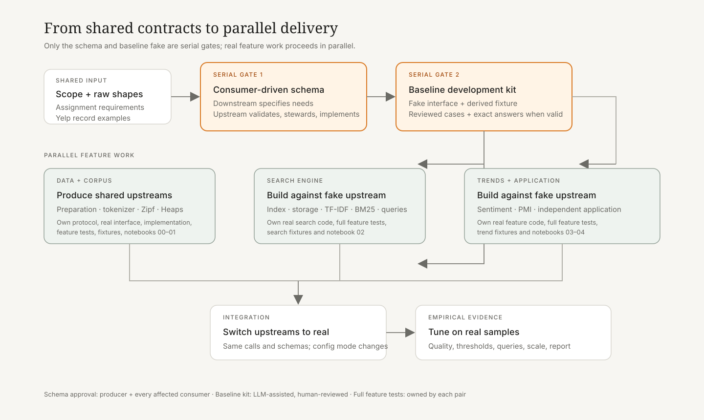

# Six-person team workflow

## Dependency logic

The project uses three pairs, but the work does not begin as three independent branches. Everyone first agrees on the cross-feature boundaries; after that gate, the pairs can work in parallel against stable fake upstreams.



In the diagram, dependency colors are used only at cross-group boundaries: Group A's provided `PreparedReviewReader` is blue and its shared `Tokenizer` is purple; the same colors reappear where Groups B/C consume them. Group A's own internal inputs remain neutral. Box styling continues to mean input, work, or output, so dependency identity does not obscure node responsibility.

### Facility dependency register

| Work unit | Required upstream facilities | Work performed | Facilities/artifacts provided |
| --- | --- | --- | --- |
| data preparation | raw Yelp business and review JSON | stream, validate, join business metadata, normalize dates/categories, audit rejected and unmatched records | canonical `reviews.jsonl`, audit files, and `PreparedReviewReader` |
| tokenizer | prepared review text plus approved token policy | normalize/tokenize and emit a compatibility fingerprint | shared `Tokenizer` |
| Zipf/Heaps/tokenizer comparison | `PreparedReviewReader`, shared tokenizer, baseline tokenizers | corpus counting, fitting and comparison | metrics, tables and figures; no new cross-group runtime dependency |
| index build/storage | `PreparedReviewReader` + shared `Tokenizer` | build postings/statistics, persist index and tokenizer metadata | index artifact and real `SearchIndex`/reader facade |
| query/ranking/evaluation | index facade + the same shared `Tokenizer` | tokenize queries, score TF-IDF/BM25, rank and evaluate | ranked results, query evaluation and report artifacts |
| sector sentiment | `PreparedReviewReader`: original `text`, `review_date`, `categories` | run VADER on the full original review text, then aggregate by period/sector | sentiment time series with review counts |
| PMI drift | `PreparedReviewReader` + shared `Tokenizer` | form the approved context, count co-occurrence and compute/filter PMI | ranked term associations by period |
| comparison application | `PreparedReviewReader`: original `text` and `doc_id` | sentence splitting plus comparison detection/evaluation inside Group C | matched sentences, cues/labels and evaluation metrics |

The shared tokenizer is therefore **not** a blanket dependency of trend/application work. Sentiment should preserve the complete review string because VADER uses punctuation, capitalization, emoji and negation cues. PMI requires the shared tokenizer so term identity is stable across periods. The comparison application uses original text and owns its sentence segmentation; it should depend on the shared tokenizer only if the final approved method genuinely needs token-level cues.

The required order is:

1. agree on assignment scope, raw Yelp shapes, and which outputs cross feature boundaries;
2. downstream consumers state what they need, and the upstream producer freezes a jointly approved schema;
3. let Groups B and C independently create schema-conforming fake upstreams and test data for their own work;
4. let all three pairs implement and test their own complete feature in parallel;
5. replace fake upstreams with real upstreams by switching runtime mode only;
6. tune empirical choices on real samples, then run final notebooks and report experiments.

The serial dependency stops at the approved schema and usable fake. Group B does not wait for Group A's real tokenizer or prepared dataset, and Group C does not wait for Group A's full-data experiments.

## Responsibilities

| Pair | Assignment scope | Upstream dependency | Outputs consumed elsewhere |
| --- | --- | --- | --- |
| Data and corpus analysis | preparation, tokenizer, Zipf, Heaps, tokenizer comparison (§3.1-§3.2) | raw Yelp business/review records | prepared reviews and tokenizer |
| Search engine | index, persistence, TF-IDF, BM25, query and retrieval analysis (§3.3) | prepared reviews and tokenizer | none; its index and ranked results remain group-internal/report artifacts |
| Trends and application | sentiment, PMI drift, independent NLP/IR application (§3.4-§3.5) | prepared reviews for all tasks; shared tokenizer for PMI only | none; its results are terminal report/application artifacts |

An internal helper or final report artifact is not a shared schema. Under the current design, the only cross-feature runtime schemas are `PreparedReviewReader` and `Tokenizer`.

## Who defines and who implements a schema

Use a **consumer-defined, producer-implemented** rule:

- Groups B and C jointly write the required fields, signatures, behavior, examples and edge cases in `protocol/reviewer.py` and `protocol/tokenizer.py`;
- Group A reviews whether the proposal can be implemented efficiently from Yelp data, but does not replace it with a producer-centric schema;
- B and C approve one shared version before it is frozen;
- Group A implements the real interface and must conform to that frozen version;
- B and C each implement their own fake against the same protocol and may use different records for their own algorithms.

The target is **consumer-complete and minimal**, not speculative redundancy. A derived field belongs in the shared schema only when B or C actually consumes it and its meaning is stable. Group A may flag an infeasible or ambiguous requirement, which returns to B/C for revision rather than being changed unilaterally.

### Boundary ownership

| Boundary | Schema owners | Feasibility reviewer | Real implementation |
| --- | --- | --- | --- |
| prepared reviews | search pair + trend/application pair | data/corpus pair | data/corpus pair |
| tokenizer | search pair + trend/application pair (PMI requirements only for C) | data/corpus pair | data/corpus pair |

Groups B/C steward `src/yelptext/protocol/reviewer.py` and `tokenizer.py`. Group A exposes the real implementations through `src/yelptext/interface/data_corpus_analysis.py`. Fixture mode selects either B's `tests/fake/search_engine/data_corpus_analysis.py` or C's `tests/fake/trend_application/data_corpus_analysis.py`. Search and trend/application types stay inside their own interface/implementation directories and do not enter `protocol/`.

## What is created when a schema is frozen

For each proposed boundary, B/C first create one coherent schema change containing:

1. the approved protocol and serialized example;
2. example calls for both consumers;
3. field/behavior decisions and edge cases;
4. Group A's implementability review.

After schema approval, B and C separately add their fake `data_corpus_analysis` module, the smallest fixture needed by their algorithms, and independently checked expected answers where exact answers exist. An LLM may help draft records and enumerate edges, but the owning consumer group reviews and owns the result. It must not silently decide an unresolved tokenizer policy, ranking convention, threshold, label, or other ground truth.

These consumer-owned fakes unblock development but do not replace each group's full feature tests. In parallel, Group A implements the same protocols against real/raw data.

## What each pair writes after the shared gate

### Data and corpus analysis pair

Owned locations:

```text
src/yelptext/cli/data_corpus_analysis.py
src/yelptext/command/data_corpus_analysis.py
src/yelptext/protocol/reviewer.py
src/yelptext/protocol/tokenizer.py
src/yelptext/interface/data_corpus_analysis.py
src/yelptext/implementation/data_corpus_analysis/**
tests/fixtures/data_corpus_analysis/**
tests/test_data_corpus_analysis.py
notebooks/01_zipf.ipynb
notebooks/02_heaps.ipynb
notebooks/03_tokenizer_comparison.ipynb
```

The pair implements preparation, tokenizer behavior, corpus statistics, command orchestration, and report evidence. It also maintains the prepared-review and tokenizer boundary. Synthetic tests cover fixed behavior and edge cases; tokenizer policy and corpus-level quality require real-sample analysis.

### Search-engine pair

Owned locations:

```text
src/yelptext/cli/search_engine.py
src/yelptext/command/search_engine.py
src/yelptext/interface/search_engine.py
src/yelptext/implementation/search_engine/**
tests/fake/search_engine/data_corpus_analysis.py
tests/fixtures/search_engine/**
tests/test_search_engine.py
notebooks/04_search_engine.ipynb
```

The pair tests more than its interface: index construction, persistence, exact TF-IDF/BM25 calculations, ordering and ties, empty/missing terms, command orchestration, CLI fixture-mode artifacts, and real-query analysis. While Group A is unfinished, its real search implementation receives the fake data/corpus interface automatically.

### Trend/application pair

Owned locations:

```text
src/yelptext/cli/trend_application.py
src/yelptext/command/trend_application.py
src/yelptext/interface/trend_application.py
src/yelptext/implementation/trend_application/**
tests/fake/trend_application/data_corpus_analysis.py
tests/fixtures/trend_application/**
tests/test_trend_application.py
notebooks/05_sentiment_and_pmi.ipynb
notebooks/06_application_demo.ipynb
```

The pair owns sentiment, aggregation, PMI, sentence-level comparison detection, CLI artifacts, and report interpretation. Sentiment passes each original review string directly to VADER and does not use the shared tokenizer. PMI consumes the shared tokenizer. The comparison application owns sentence segmentation and consumes original review text. Exact counts and PMI examples can use fixtures; sector choice, minimum counts, sentiment interpretation, thresholds, and application quality require real samples.

Each pair writes and expands its own `test_<feature>.py` while implementing the feature. B/C's fake data are inputs to these tests, not substitutes for testing their real feature code.

## Fixture mode and real mode

The function under development is always real. Runtime mode selects only its upstream dependencies:

```text
fixture for B: tests.fake.search_engine.<upstream_feature>
fixture for C: tests.fake.trend_application.<upstream_feature>
real:          yelptext.interface.<upstream_feature>
```

For example, a search fixture run follows:

```text
CLI search/index command
  -> real search command
  -> real search interface and implementation
  -> fake data_corpus_analysis interface
```

Changing the config to `real` resolves the last line to `yelptext.interface.data_corpus_analysis`. Search imports, signatures, function calls, and internal file paths do not change.

## Test cases and standard answers

Use an expected answer only when the approved behavior has a defensible exact result:

- exact answers: joins, counts, postings, formula scores, deterministic ordering, fixed PMI examples, explicitly defined rule labels;
- structural checks: schemas, serialization, determinism, invariants, error behavior, artifact completeness;
- real-data evaluation: tokenizer policy, query usefulness, BM25 settings, PMI thresholds/stability, sentiment interpretation, application precision/recall, performance and memory.

A fake interface's returned data is an input to the feature under test, not that feature's expected output. Never generate an oracle with the implementation being tested, and never change an oracle merely to make a failing implementation pass.

## Shared-file rule

- `src/yelptext/cli/main.py` and `src/yelptext/runtime/` are integration-owned; change them only when composition itself changes.
- Each pair edits its own semantic files and directories.
- A protocol change requires its steward and at least one affected consumer.
- Consumer code never imports `tests.fake` directly and algorithms contain no `if fixture` branch.
- Reusable logic belongs in `src/yelptext`; notebooks display and interpret it.
- Do not commit Yelp data, large artifacts, secrets, or unnecessary notebook output.
