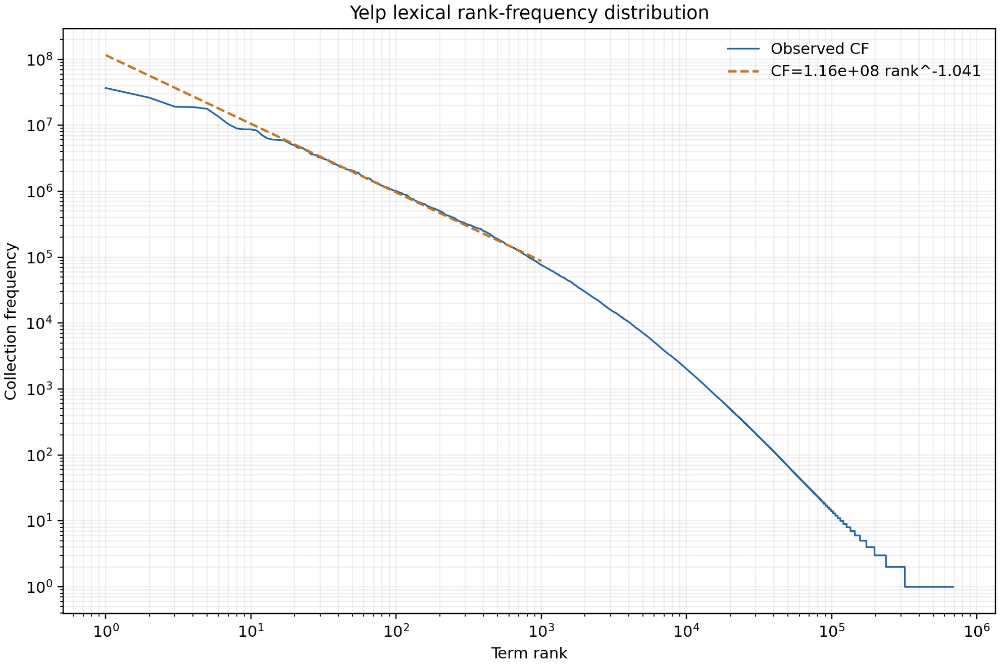
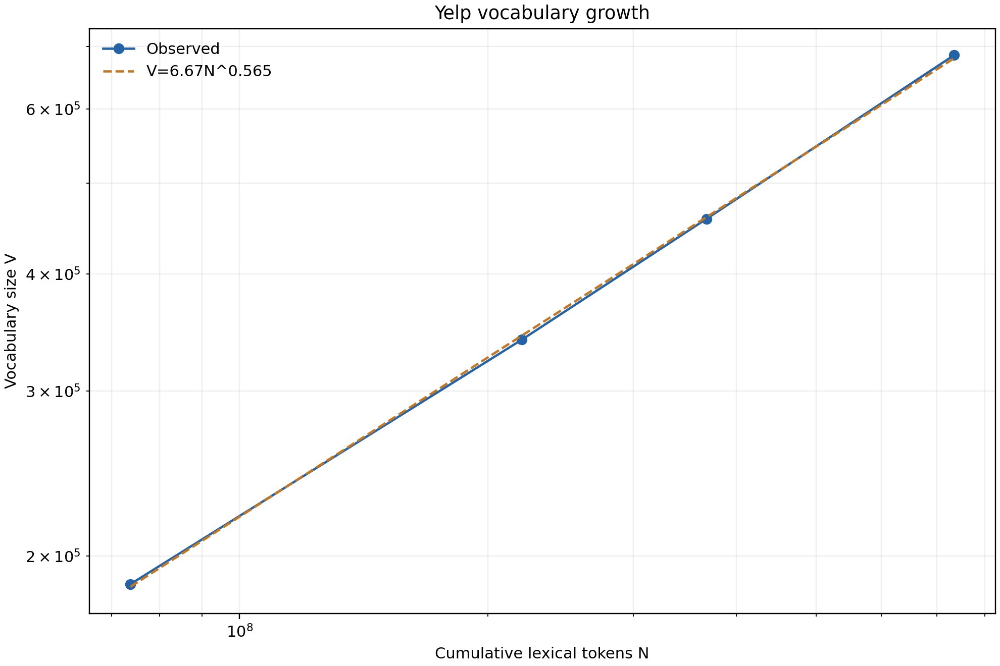

# 3.1 Dataset Analysis: Empirical Laws and Custom Tokenization

This section addresses the dataset-analysis component in Assignment Section 3.2. We used the Yelp Open Dataset review and business files. The corpus contains 6,990,280 reviews linked to 150,346 businesses. Preparation preserved the original review text and attached business metadata through `business_id`; all 6,990,280 valid, unique reviews were retained. Corpus-wide experiments used the full prepared dataset, whereas tokenizer comparison used a deterministic sample of 50,000 reviews selected with seed 42. Processing was streaming so that neither the 6.36 GB prepared file nor the complete vocabulary had to be loaded into memory.

## 3.1.1 Custom Regex Tokenizer

Yelp reviews contain structures that generic whitespace or punctuation tokenizers do not handle consistently. We implemented a regex tokenizer from scratch with ordered rules for URLs, email addresses, emoticons, composed emoji, structured numeric expressions, hashtags, and words. Text is normalized to Unicode NFC, apostrophe variants are mapped to a straight apostrophe, full-width `?!#` characters are normalized, and terms are lowercased. Contractions such as `don't` remain one term; hyphenated run-on forms such as `the-best-food` become lexical words without retaining the hyphens. Grouped numbers, money, percentages, temperatures, URLs, hashtags, emoji sequences, and common emoticons are preserved as meaningful units. Expressive `!`, `?`, and `#` tokens remain available to consumers, while downstream lexical analyses can exclude them.

The central implementation compiles the alternatives once and applies the first matching rule at every covered span:

```python
TOKEN_PATTERN = re.compile("|".join((
    URL_PATTERN, EMAIL_PATTERN, EMOTICON_PATTERN, EMOJI_PATTERN,
    NUMERIC_TOKEN_PATTERN, HASHTAG_PATTERN, WORD_PATTERN, r"[!?#]",
)), flags=re.IGNORECASE | re.UNICODE)

def tokenize(text):
    normalized = normalize(text)
    tokens = []
    for match in TOKEN_PATTERN.finditer(normalized):
        token = match.group(0)
        if token.startswith(("http://", "https://", "www.")):
            token = token.rstrip(".,!?;:")
        elif token[-1] in "$€£¥" and token[0].isdigit():
            token = token[-1] + token[:-1]
        tokens.append(token)
    return tokens
```

We compared the custom tokenizer with NLTK Whitespace and WordPunct on the same seed-42 sample. Every method received the same Unicode, apostrophe, width, and case normalization; no stopword removal, stemming, lemmatization, or punctuation filtering was applied.

| Tokenizer | Tokens | Vocabulary | Hapax share | Processing time |
|---|---:|---:|---:|---:|
| NLTK Whitespace | 5,230,295 | 147,557 | 59.03% | 2.24 s |
| NLTK WordPunct | 6,115,281 | 53,840 | 41.27% | 2.45 s |
| Custom Yelp | 5,323,427 | 56,043 | 42.18% | 9.66 s |

Whitespace produced the fewest boundaries but the largest vocabulary. Its 147,557 types are largely caused by punctuation-attached words, unsplit compounds, and text-emoji combinations; the custom tokenizer reduced this vocabulary by 62.0%. WordPunct generated 12.9% more tokens than the custom method by splitting contractions, decimals, currency expressions, URLs, hashtags, and emoji components aggressively. Aggregate vocabulary sizes therefore do not by themselves establish quality. Qualitative cases show that the custom tokenizer preserves `don't`, `$10`, a complete URL, `#deal`, and composed emoji according to the project's term policy, while splitting `the-best-food` into three searchable words. The custom method was approximately five to six times slower in a bounded repeated benchmark, but its throughput of about 5,621 reviews per second is acceptable for offline indexing. These examples validate the intended project policy rather than claiming universal linguistic superiority.

## 3.1.2 Zipf's Law

We built full-corpus collection frequencies (CF) and document frequencies (DF) using the custom tokenizer. Punctuation-tagged terms were excluded from the lexical analysis, leaving 734,871,222 lexical token occurrences and 685,120 observed lexical types. Terms were sorted by descending CF and assigned rank (i). We fitted the log-linear form

\[
\log CF_i = \log K + b\log i
\]

by ordinary least squares. The high-frequency core (ranks 1--1,000) produced (b=-1.041), (K=1.161\times10^8), and (R^2=0.9928). Thus the core is close to the classical Zipf expectation (b\approx-1), and the log-log relationship is strongly linear. Figure 1 shows the observed rank-frequency curve and the fitted relation.



The agreement is not uniform over the complete vocabulary. Ranks 1,000--100,000 have a substantially steeper slope of -2.061 as frequencies approach the rare-term region. Consequently, fitting ranks 10--100,000 as one line would produce a misleading slope near -2 despite a Zipf-like high-frequency core. The fitted (K) is the regression intercept's rank-one extrapolation; it should not be confused with the observed rank-one CF of 36,808,193. The result empirically supports Zipf-like behavior over the central high-frequency regime while also documenting systematic tail deviation.

## 3.1.3 Heaps' Law

Heaps' Law requires intermediate growth observations rather than only the final vocabulary. We therefore streamed the prepared reviews in their stable file order and recorded cumulative token count (N) and vocabulary size (V) after 10%, 30%, 50%, and 100% of reviews. The accumulation and log-space fit were performed as follows:

```python
seen, N = set(), 0
for review_number, review in enumerate(reader.iter_reviews(), start=1):
    terms = [term for term in tokenizer.tokenize(review["text"])
             if term not in {"!", "?", "#"}]
    N += len(terms)
    seen.update(terms)
    if review_number in checkpoints:
        growth.append((N, len(seen)))

beta, log_k = np.polyfit(np.log(N_values), np.log(V_values), 1)
k = np.exp(log_k)
```

| Reviews used | Tokens (N) | Observed (V) | Fitted (V) | Relative error |
|---:|---:|---:|---:|---:|
| 10% | 73,726,187 | 186,721 | 185,514 | -0.65% |
| 30% | 219,745,070 | 340,382 | 343,787 | +1.00% |
| 50% | 368,198,271 | 458,237 | 460,161 | +0.42% |
| 100% | 734,871,222 | 685,120 | 679,894 | -0.76% |

Fitting (V=kN^\beta) over all four checkpoints gave (k=6.672), \(\beta=0.565\), and log-space (R^2=0.9998). The exponent is close to the commonly observed value around 0.5 and confirms sublinear vocabulary growth: additional text continues to introduce new types, but at a decreasing rate. The fitted values differ from the observations by at most approximately 1% at the four measured checkpoints. As a simple extrapolation check, fitting only the 10%, 30%, and 50% points predicts 670,663 types at 100%, 2.11% below the observed 685,120.



The estimated (k) is below the informal 30--100 range sometimes quoted for other corpora. This does not invalidate the model: (k) extrapolates vocabulary size to (N=1) and is sensitive to tokenization, language, corpus domain, and fitting range. Yelp-specific names, URLs, spelling variation, and expressive forms also affect type growth. The very high (R^2), small checkpoint errors, and held-out extrapolation error show that the fitted curve is an effective descriptive model for this corpus, although the four nested checkpoints are not independent samples and do not constitute a formal power-law goodness-of-fit test.

## 3.1.4 Limitations

The tokenizer is an English-oriented, Yelp-specific rule system and is not a universal linguistic segmenter. The baseline comparison uses 50,000 reviews rather than the full corpus, and its runtime measurements are machine-dependent. Zipf and Heaps parameters are descriptive OLS estimates whose values depend on the tokenizer and selected fitting region. Nevertheless, the combined quantitative and qualitative evidence supports using the custom tokenizer consistently for the project's vocabulary construction and downstream search experiments.

## References for this section

1. Yelp, "Yelp Open Dataset," https://www.yelp.com/dataset.
2. S. Bird, E. Klein, and E. Loper, *Natural Language Processing with Python*. O'Reilly Media, 2009. (NLTK)
3. C. R. Harris et al., "Array programming with NumPy," *Nature*, vol. 585, pp. 357--362, 2020.
4. J. D. Hunter, "Matplotlib: A 2D graphics environment," *Computing in Science & Engineering*, vol. 9, no. 3, pp. 90--95, 2007.
5. W. McKinney, "Data structures for statistical computing in Python," in *Proceedings of the 9th Python in Science Conference*, 2010. (pandas)
6. G. K. Zipf, *Human Behavior and the Principle of Least Effort*. Addison-Wesley, 1949.
7. H. S. Heaps, *Information Retrieval: Computational and Theoretical Aspects*. Academic Press, 1978.
