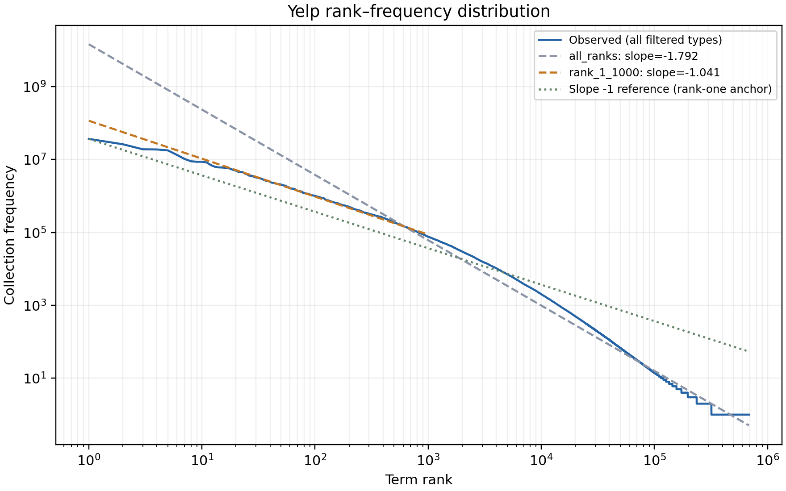
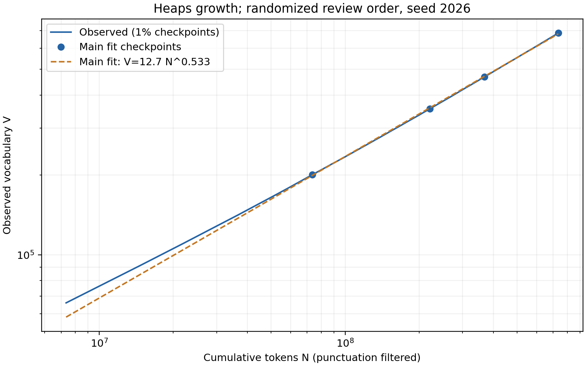
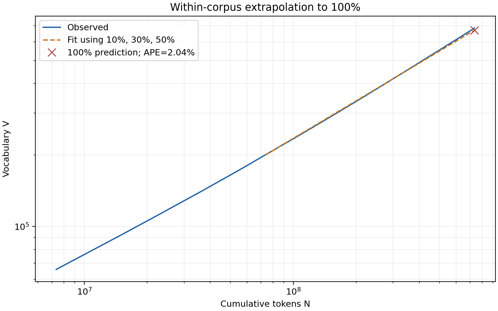

# 3.1 Dataset Analysis: Empirical Laws and Custom Tokenization

We used the Yelp Open Dataset review and business files, containing 6,990,280 reviews and 150,346 business records, respectively. Preparation preserved the original review text and attached business metadata through `business_id`; all 6,990,280 valid, unique reviews were retained. Corpus-wide experiments used the full prepared dataset, whereas tokenizer comparison used a deterministic sample of 50,000 reviews selected with seed 42. Reviews were processed as a stream. Zipf analysis read the completed frequency table, while Heaps analysis stored the randomized review order and accumulated vocabulary in SQLite.

## 3.1.1 Custom Regex Tokenizer

Yelp reviews contain contractions, prices, URLs, hashtags, emoji, emoticons, and informal punctuation that generic tokenizers handle inconsistently. We therefore implemented a regex tokenizer from scratch. Before matching, it applies Unicode NFC normalization, maps apostrophe variants to a straight apostrophe, normalizes full-width `?!#`, and lowercases text. Ordered patterns then recognize URLs, email addresses, emoticons, composed emoji, structured numeric expressions, hashtags, words, and the independent `!`, `?`, and `#` tokens. Contractions such as `don't` remain one term; hyphenated forms such as `the-best-food` become separate lexical words. Grouped numbers, money, percentages, temperatures, URLs, hashtags, emoji sequences, and common emoticons are retained as meaningful units.

The same tokenizer policy is exposed through the shared pipeline used by vocabulary construction and search. Classification is separate from tokenization: consumers may retain or remove punctuation and stop words without changing token boundaries. This is important because the Zipf and Heaps experiments exclude `!`, `?`, and `#`, whereas search retains stop words but filters punctuation.

The central matching logic is:

```python
TOKEN_PATTERN = re.compile("|".join((
    URL_PATTERN, EMAIL_PATTERN, EMOTICON_PATTERN, EMOJI_PATTERN,
    NUMERIC_TOKEN_PATTERN, HASHTAG_PATTERN, WORD_PATTERN, r"[!?#]",
)), flags=re.IGNORECASE | re.UNICODE)

def tokenize(text):
    normalized = normalize(text)
    tokens = []
    for match in TOKEN_PATTERN.finditer(normalized):
        token = match.group(0)
        if token.startswith(("http://", "https://", "www.")):
            token = token.rstrip(".,!?;:")
        elif token[-1] in "$€£¥" and token[0].isdigit():
            token = token[-1] + token[:-1]
        tokens.append(token)
    return tokens
```

We compared the custom tokenizer with NLTK Whitespace and WordPunct on the same seed-42 sample. Every method received the same Unicode, apostrophe, width, and case normalization; no stopword removal, stemming, lemmatization, or punctuation filtering was applied.

| Tokenizer       |    Tokens | Vocabulary | Hapax share | Full processing time |
| --------------- | --------: | ---------: | ----------: | -------------------: |
| NLTK Whitespace | 5,230,295 |    147,557 |      59.03% |               2.24 s |
| NLTK WordPunct  | 6,115,281 |     53,840 |      41.27% |               2.45 s |
| Custom Yelp     | 5,323,427 |     56,043 |      42.18% |               9.66 s |


Whitespace produced the fewest token boundaries but the largest vocabulary. Its 147,557 types are largely caused by punctuation-attached words, unsplit compounds, and text-emoji combinations; the custom tokenizer reduced this vocabulary by 62.0%. WordPunct generated 12.9% more tokens than the custom method by aggressively splitting contractions, decimals, currency expressions, URLs, hashtags, and emoji components. The custom method instead preserved examples such as `don't`, `$10`, a complete URL, `#deal`, and composed emoji according to the project's term policy, while splitting `the-best-food` into three searchable words.

Runtime is reported as an engineering trade-off rather than a quality metric. On a bounded 500-review benchmark repeated five times, median throughput was 33,476 reviews/s for Whitespace, 27,926 reviews/s for WordPunct, and 5,621 reviews/s for the custom tokenizer. The custom rules are slower, but the throughput remains practical for offline vocabulary construction and indexing. Aggregate token or vocabulary counts alone do not establish linguistic quality; the qualitative cases instead verify that the implementation follows the intended Yelp-specific policy.

## 3.1.2 Zipf's Law

We built full-corpus collection frequencies (CF) and document frequencies (DF) using the custom tokenizer. Independent `!`, `?`, and `#` tokens were excluded from the analysis, leaving 734,871,222 token occurrences and 685,120 observed types. Stopwords and all other observed token types were retained. Terms were sorted by descending CF and assigned rank \(i\). We fitted the log-linear form

\[
\log CF_i = \log K + b\log i
\]

by ordinary least squares. Across all 685,120 ranks, the fit gave \(b=-1.792\), \(K=1.454\times10^{10}\), and log-space \(R^2=0.9616\). For the high-frequency core, ranks 1--1,000 gave \(b=-1.041\), \(K=1.161\times10^8\), and log-space \(R^2=0.9928\). The core slope is close to the classical Zipf expectation \(b\approx-1\), whereas the full-rank fit is substantially steeper.



The complete log-log curve shows curvature, and the estimated slope depends on the fitting range. Extending the upper rank boundary from 500 to 1,000 and then 5,000 changes the slope from -0.967 to -1.041 and -1.280. Ranks 1,000--100,000 give a substantially steeper slope of -2.061 despite a log-space \(R^2\) of 0.9957. Similarly, restricting the analysis to types with CF at least 5 gives a slope of -2.038. Thus, a high \(R^2\) can accompany a slope far from the classical Zipf value; here \(R^2\) describes the quality of a log-space linear fit rather than proving a universal power law.

| Fitting range  | Slope \(b\) | Log-space \(R^2\) |
| -------------- | ----------: | ----------------: |
| All ranks      |      -1.792 |            0.9616 |
| 1--500         |      -0.967 |            0.9960 |
| 1--1,000       |      -1.041 |            0.9928 |
| 1--5,000       |      -1.280 |            0.9873 |
| 1,000--100,000 |      -2.061 |            0.9957 |
| CF at least 5  |      -2.038 |            0.9911 |

Taken together, the results provide descriptive evidence of Zipf-like behavior in the high-frequency portion of the vocabulary, with steeper decay over wider fitting ranges. They do not support one classical Zipf relation across the complete vocabulary. The fitted \(K\) is the model's predicted frequency at rank one; it should not be confused with the observed count of 36,808,193 for the highest-ranked term, *the*.

## 3.1.3 Heaps' Law

Heaps' Law requires intermediate growth observations rather than only the final vocabulary. We therefore accumulated the prepared reviews in a deterministic randomized order with seed 2026 while preserving token order within each review. Randomizing the review order reduces the influence of original file ordering on intermediate growth points, while the fixed seed makes the experiment reproducible. The order was defined by keyed BLAKE2b priorities derived from document IDs. SQLite stored the review order and cumulative vocabulary.

We used the same punctuation filter as Zipf and recorded cumulative token count \(N\) and vocabulary size \(V\) after every 1% of reviews. The main fit used the 10%, 30%, 50%, and 100% checkpoints. We fitted \(V=kN^\beta\) by ordinary least squares in log space:

\[
\log V = \log k + \beta\log N.
\]

| Reviews used | Tokens \(N\) | Observed \(V\) | Fitted \(\widehat V\) | Relative error |
| -----------: | -----------: | -------------: | --------------------: | -------------: |
|          10% |   73,513,681 |        200,462 |               199,243 |         -0.61% |
|          30% |  220,533,076 |        354,662 |               357,931 |         +0.92% |
|          50% |  367,560,903 |        467,975 |               470,007 |         +0.43% |
|         100% |  734,871,222 |        685,120 |               680,064 |         -0.74% |

Fitting the four main checkpoints gave \(k=12.7243\), \(\beta=0.533251\), and log-space \(R^2=0.999757\):

\[
V=12.7243N^{0.533251}.
\]

The exponent is close to the commonly observed value around 0.5 and indicates sublinear vocabulary growth: additional text continues to introduce new types, but at a decreasing rate. Fitted values differ from observations by less than 1% at all four checkpoints.



For an extrapolation check, fitting only the 10%, 30%, and 50% points gave \(k=14.6842\) and \(\beta=0.525587\). At the observed full-corpus token count \(N=734{,}871{,}222\), this model predicted 671,150 types compared with the actual 685,120. It underestimated the vocabulary by approximately 13,970 types, giving an absolute percentage error of 2.04%. This is a within-corpus extrapolation using the observed target token count, not an independent-corpus prediction.



Sensitivity analysis shows that checkpoint density has a smaller effect than fitting interval. Over the same 10--100% interval, increasing the checkpoints from 4 to 91 changed \(\beta\) from 0.53325 to 0.53842 and \(k\) from 12.724 to 11.473. Changing the interval gave \(k=15.734,\ \beta=0.52244\) for 1--100% and \(k=9.640,\ \beta=0.54714\) for 30--100%. The later interval therefore has a steeper estimated growth rate, consistent with modest curvature in the log-log trajectory.

| Interval        | Checkpoints |  \(k\) | \(\beta\) | Log-space \(R^2\) |
| --------------- | ----------: | -----: | --------: | ----------------: |
| 10--100% (main) |           4 | 12.724 |   0.53325 |          0.999757 |
| 10--100%        |          10 | 12.162 |   0.53551 |          0.999791 |
| 10--100%        |          19 | 11.796 |   0.53703 |          0.999812 |
| 10--100%        |          91 | 11.473 |   0.53842 |          0.999849 |
| 1--100%         |         100 | 15.734 |   0.52244 |          0.999159 |
| 30--100%        |          71 |  9.640 |   0.54714 |          0.999985 |

The estimated \(k\) is below the informal 30--100 range sometimes quoted for other corpora. This does not invalidate the model: \(k\) extrapolates vocabulary size to \(N=1\) and is sensitive to token units, preprocessing, and fitting interval. The final token and vocabulary counts match the independently built CF/DF vocabulary under the same punctuation filter. The high \(R^2\), small checkpoint errors, and 2.04% nested extrapolation error show that the curve describes this corpus and review ordering well, while the correlated checkpoints should still be interpreted descriptively.

Zipf's curve shows a long tail of rare types, while Heaps' curve shows that vocabulary continues to expand as reviews are added. Both properties matter when planning storage for a search index's term dictionary. Vocabulary construction and indexing also require consistent tokenization and frequency definitions so that their statistics remain comparable.

## 3.1.4 Limitations

The tokenizer is an English-oriented, Yelp-specific rule system and is not a universal linguistic segmenter. The baseline comparison uses 50,000 reviews rather than the full corpus, and runtime measurements are machine-dependent. Zipf and Heaps parameters are descriptive OLS estimates whose values depend on the tokenizer and selected fitting region. Heaps results describe one randomized ordering with seed 2026; the nested checkpoints are correlated, and the sensitivity analysis does not measure variation across random seeds. The prediction check uses the same corpus and its observed full-corpus token count, so it does not establish predictive accuracy on an independent corpus.

## References

1. Yelp, "Yelp Open Dataset," https://www.yelp.com/dataset.
2. S. Bird, E. Klein, and E. Loper, *Natural Language Processing with Python*. O'Reilly Media, 2009.
3. G. K. Zipf, *Human Behavior and the Principle of Least Effort*. Addison-Wesley, 1949.
4. H. S. Heaps, *Information Retrieval: Computational and Theoretical Aspects*. Academic Press, 1978.
