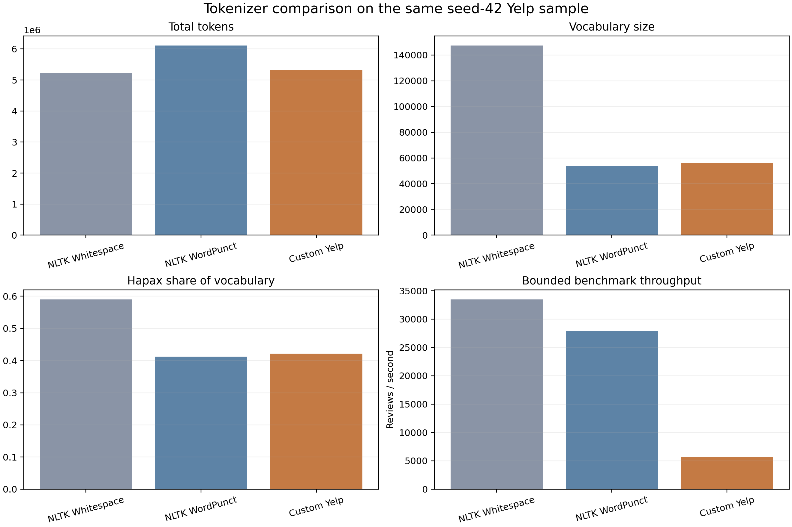
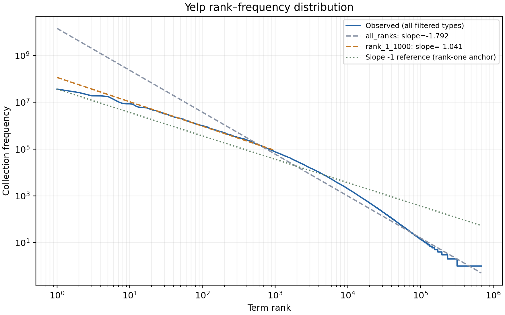
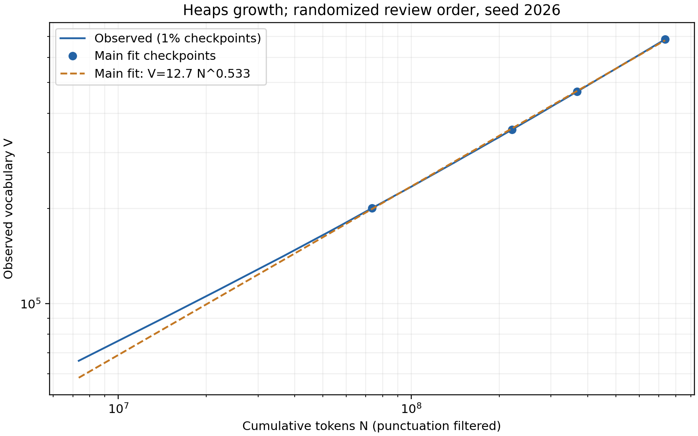
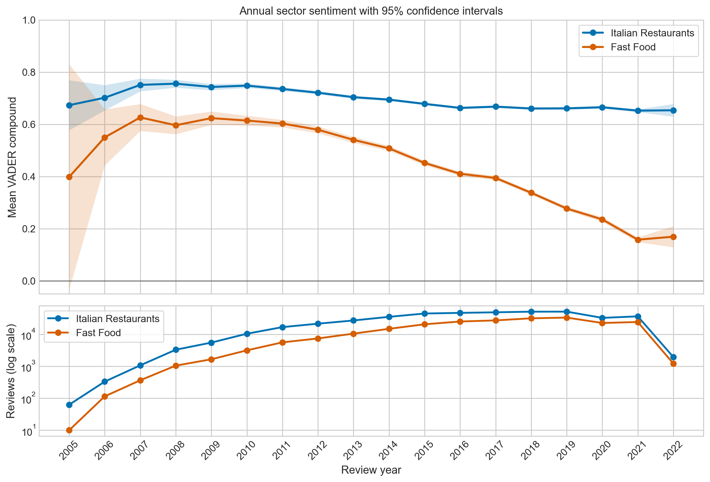
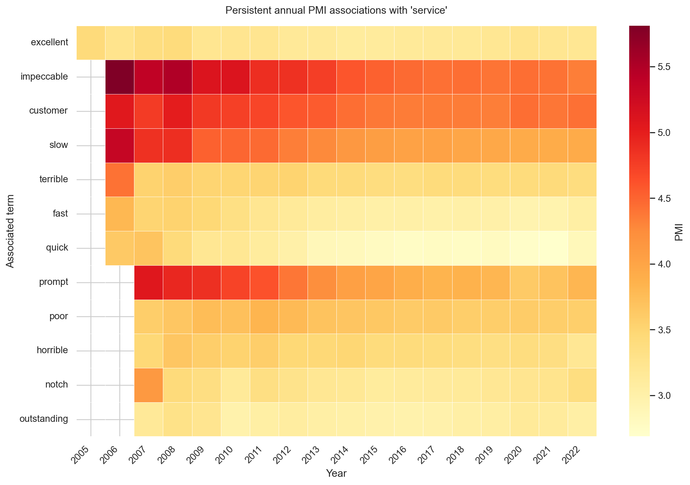

# Yelp Review Text Analysis, Search, Trends, and Comparison Mining

> **Group:** GROUP NAME
> **Course:** AI6122 Text Data Management & Processing
> The course-provided cover page will precede this main report in the final PDF.

## Abstract

This project implements an end-to-end text processing and retrieval pipeline for the Yelp Open Dataset. A custom Yelp-oriented tokenizer supports full-corpus Zipf and Heaps analyses, a persistent review-level inverted index with TF-IDF cosine and BM25 ranking, annual sector sentiment analysis, PMI-based term-association drift, and a lightweight comparison-sentence mining application. The corpus contains 6,990,280 reviews linked to 150,346 businesses; tokenizer and search experiments use a deterministic 50,000-review sample where appropriate. Zipf behavior is strongest in the high-frequency vocabulary, while Heaps fitting shows sublinear growth with exponent 0.533. TF-IDF and BM25 produce materially different Top-10 results across six exploratory queries, especially because of document-length normalization and OR matching. Trend analysis finds comparatively stable positive sentiment for Italian Restaurants, a marked decline for Fast Food, and a persistent but gradually reweighted vocabulary around *service*. Finally, an explainable rule-based application identifies 3,342 comparison sentences in the shared sample. The results are reproducible but descriptive: no relevance judgments or causal design are claimed.

## Contributions

| Member    | Contribution                                                                                                                                                                                             |
| --------- | -------------------------------------------------------------------------------------------------------------------------------------------------------------------------------------------------------- |
| LUO PEIAO | Set up the codebase structure and utils, integrated and consolidated the various modules into src, worked on sections 3.4.1, 3.4.2, and 3.5, and made optimizations to the tokenizer and index builder. |
| MA ZIWEN  | Prepared the Yelp dataset, compared tokenizers, conducted Zipf’s and Heaps’ law analyses, and wrote the corresponding report sections. |
| ZHAO YIFAN | Mainly worked on section 3.1.1, built up the custom regex tokenizer from scratch, and generated the vocabulary files for downstream tasks. |
|           |                                                                                                                                                                                                          |
|           |                                                                                                                                                                                                          |
|           |                                                                                                                                                                                                          |

## 1. Data and System Design

We used `business.json` and `review.json` from the Yelp Open Dataset. Preparation streams and validates both files, joins business metadata through `business_id`, and writes a canonical JSONL representation containing stable review ID, original text, date, stars, business name, categories, city, and state. All 6,990,280 valid unique reviews were retained. Full-corpus analyses stream this prepared file; tokenizer comparison, search, and the final application reuse an order-independent 50,000-review bottom-\(k\) sample selected with seed 42. This combination gives reliable corpus statistics while keeping interactive experiments reproducible and manageable.

The software follows one dependency direction:

```text
CLI -> command/configuration -> public interface -> implementation
```

Algorithms reside in `src/yelptext/implementation/`, not in notebooks. Commands generate CSV, JSON, SQLite, and figure artifacts; six notebooks form a presentation layer over those saved outputs. Expensive jobs use streaming or disk-backed state so that the multi-gigabyte corpus is not loaded into memory.

## 2. Dataset Analysis: Empirical Laws and Custom Tokenization

### 2.1 Custom tokenizer

Yelp text contains contractions, prices, URLs, hashtags, emoji, emoticons, informal punctuation, and hyphenated expressions. Our tokenizer first applies Unicode NFC normalization, normalizes apostrophe and full-width punctuation variants, and lowercases text. Ordered regular expressions then recognize URLs, emails, emoticons, composed emoji, structured numeric expressions, hashtags, words, and independent `!`, `?`, and `#` tokens. Contractions such as `don't` remain one token, while `the-best-food` becomes three searchable words. Classification and filtering are separate from segmentation, allowing each consumer to remove punctuation or stop words without changing token boundaries.

```python
TOKEN_PATTERN = re.compile("|".join((
    URL_PATTERN, EMAIL_PATTERN, EMOTICON_PATTERN, EMOJI_PATTERN,
    NUMERIC_TOKEN_PATTERN, HASHTAG_PATTERN, WORD_PATTERN, r"[!?#]",
)), re.IGNORECASE | re.UNICODE)

def tokenize(text):
    return [normalize_match(m.group(0)) for m in TOKEN_PATTERN.finditer(normalize(text))]
```

We compared the custom tokenizer with NLTK Whitespace and WordPunct on the same seed-42 sample under identical normalization and without stopword or punctuation removal.

| Tokenizer       |    Tokens | Vocabulary | Hapax share |   Time |
| --------------- | --------: | ---------: | ----------: | -----: |
| NLTK Whitespace | 5,230,295 |    147,557 |      59.03% | 2.24 s |
| NLTK WordPunct  | 6,115,281 |     53,840 |      41.27% | 2.45 s |
| Custom Yelp     | 5,323,427 |     56,043 |      42.18% | 9.66 s |



Whitespace creates an inflated vocabulary through punctuation-attached and unsplit forms; the custom tokenizer reduces it by 62.0%. WordPunct produces 12.9% more tokens than the custom method by splitting contractions, numbers, URLs, hashtags, and emoji components. The custom rules are slower, but a bounded repeated benchmark still processed about 5,621 reviews/s, acceptable for offline indexing. Qualitative inspection confirmed the intended preservation of `don't`, `$10`, full URLs, `#deal`, composed emoji, and structured numbers.

### 2.2 Zipf's Law

After excluding independent `!`, `?`, and `#` tokens, the full corpus contains 734,871,222 lexical occurrences and 685,120 types. Terms were ranked by collection frequency and fitted by ordinary least squares in log space:

\[
\log CF_i=\log K+b\log i.
\]

Ranks 1--1,000 give \(b=-1.041\), \(K=1.161\times10^8\), and \(R^2=0.9928\), close to the classical \(-1\) slope. The whole vocabulary instead gives \(b=-1.792\), while ranks 1,000--100,000 give \(-2.061\). Thus the high-frequency core is Zipf-like, but one classical line does not describe the curved rare-term tail; a high log-space \(R^2\) alone is not evidence for a universal power law.



### 2.3 Heaps' Law

To reduce source-order effects, reviews were accumulated in a deterministic seed-2026 order defined by keyed BLAKE2b priorities over document IDs. SQLite stored this order and the cumulative vocabulary. We recorded one-percent growth points and fitted the predeclared 10%, 30%, 50%, and 100% checkpoints using \(V=kN^\beta\):

| Reviews | Tokens \(N\) | Observed \(V\) | Fitted \(\widehat V\) |
| ------: | -----------: | -------------: | --------------------: |
|     10% |   73,513,681 |        200,462 |               199,243 |
|     30% |  220,533,076 |        354,662 |               357,931 |
|     50% |  367,560,903 |        467,975 |               470,007 |
|    100% |  734,871,222 |        685,120 |               680,064 |

The main model is \(V=12.7243N^{0.533251}\) with log-space \(R^2=0.999757\), demonstrating sublinear vocabulary growth. Fitting only 10%, 30%, and 50% predicts 671,150 types at the final token count, 2.04% below the observed 685,120. Sensitivity analysis gives \(\beta=0.5224\) over 1--100% and 0.5471 over 30--100%, showing modest dependence on fitting interval rather than failure of the descriptive model.



## 3. Search Engine

### 3.1 Index and ranking models

The search engine retrieves individual reviews. The shared pipeline filters punctuation but retains stop words, preserving terms such as `not` that affect information needs. Each posting stores term, internal document number, and within-document frequency. SQLite also stores external `doc_id`, display metadata, document length, TF-IDF norm, document frequency, IDF, format version, and tokenizer fingerprint. Construction uses a temporary database and publishes only a completed index; loading is read-only.

TF-IDF uses logarithmic TF, smoothed IDF, and full-vector cosine normalization:

\[
\operatorname{idf}_T(t)=\ln\frac{N+1}{df_t+1}+1,
\qquad
s_T(q,d)=\frac{\sum_t w(t,q)w(t,d)}{\|\mathbf w_q\|_2\|\mathbf w_d\|_2}.
\]

BM25 uses positive IDF, \(k_1=1.5\), \(b=0.75\), and the global average document length:

\[
\operatorname{idf}_B(t)=\ln\left(1+\frac{N-df_t+0.5}{df_t+0.5}\right),
\]

\[
s_B(q,d)=\sum_t f_{t,q}\operatorname{idf}_B(t)
\frac{f_{t,d}(k_1+1)}{f_{t,d}+k_1(1-b+b|d|/\mathrm{avgdl})}.
\]

Candidates are the union of postings for known query terms, giving OR matching. Results are ordered by decreasing score and then `doc_id`, while empty and all-OOV queries return no result. SQLite performs persistence only; both ranking formulas are implemented directly.

### 3.2 Experiment and results

The deterministic sample index contains 50,000 reviews, 56,040 terms, 5,247,734 retained occurrences, and \(\mathrm{avgdl}=104.95468\). Six queries cover service, cuisine/price, ambience, delivery, meal preference, and negated value judgment. With \(K=10\), all first-ranked documents differ between models.

| Query                      | Top-10 overlap | Mean length TF-IDF / BM25 | All-term coverage TF-IDF / BM25 |
| -------------------------- | -------------: | ------------------------: | ------------------------------: |
| good service               |              3 |               14.8 / 20.6 |                     0.90 / 1.00 |
| cheap Italian restaurant   |              3 |               25.7 / 77.8 |                     0.10 / 0.40 |
| family friendly atmosphere |              6 |               23.5 / 31.6 |                     0.60 / 1.00 |
| slow delivery              |              4 |               22.8 / 65.7 |                     0.10 / 0.60 |
| best coffee and breakfast  |              2 |               24.0 / 62.9 |                     0.10 / 0.80 |
| not worth the price        |              4 |               19.1 / 34.0 |                     0.40 / 1.00 |

BM25 returns longer reviews and higher all-term lexical coverage for every query, but coverage is not relevance. For `cheap Italian restaurant`, TF-IDF first retrieves a Mexican restaurant matching only *cheap*, whereas BM25 first retrieves an inexpensive Italian-chain meal; lower results can still use *cheap* in the opposite sense. For `slow delivery`, matches may concern dish arrival rather than delivery service. For `not worth the price`, BM25's first result expresses the intended negative judgment, while TF-IDF first retrieves a positive price discussion without *not*. These cases expose OR matching, word-sense, and negation limitations rather than scoring errors.

Parameter sensitivity confirms the importance of length normalization. Setting \(b=0\) increases mean result length from 20.6--77.8 tokens to 218.1--479.9 across the six queries and retains only 0--3 baseline Top-10 documents. Changing \(k_1\) from 0.5 to 2 at \(b=0.75\) preserves every first result, although some lower ranks change. This is a stability analysis, not parameter optimization: no human relevance set was created, so Precision, Recall, MAP, and nDCG are not reported.

## 4. Trend Analysis

### 4.1 Sector sentiment

We selected two commercially interpretable sectors. Italian Restaurants requires both `Italian` and `Restaurants`; Fast Food requires `Fast Food`. Matching uses exact Yelp category membership, not substring or fuzzy search. VADER scores original review text, preserving punctuation, capitalization, degree modifiers, and negation. Compound scores are aggregated online by year and sector; positive and negative thresholds are 0.05 and -0.05. A 95% normal interval \(\bar{x}\pm z_{0.975}s/\sqrt n\) is reported for each annual mean.

The full run matched 660,089 distinct reviews, producing 439,358 Italian Restaurant and 233,008 Fast Food assignments; 12,277 reviews matched both. Review-weighted mean compound scores are 0.679 and 0.366, with mean star ratings 3.781 and 3.029.



Italian Restaurant sentiment is comparatively stable: it peaks at 0.756 in 2008 and declines gradually to 0.652 in 2021. Fast Food falls much more sharply, from 0.614 in 2010 to 0.452 in 2015, 0.277 in 2019, and 0.158 in 2021. Over 2010--2021, its positive share drops from 84.7% to 55.7%, while negative share rises from 13.6% to 40.9%. Early years have wide intervals because of sparse data, and 2022 is incomplete, so neither endpoint should be overinterpreted. The sector contrast is observational and may combine changing businesses, reviewers, locations, and expectations.

### 4.2 Term co-occurrence drift

We selected `service`, which occurs 2,318,574 times in 1,903,581 reviews. For each year, directed centre-to-context events were counted within five raw token positions on either side. Stop words, conjunctions, and punctuation cannot become ranked terms, but their positions remain so filtering cannot bring distant words together. Windows never cross review boundaries.

\[
\operatorname{PMI}_y(t,c)=
\log_2\frac{C_y(t,c)N_y}{C_y(t,*)C_y(*,c)}.
\]

To suppress rare-pair inflation, a candidate must satisfy
\(C_y(t,c)\geq\max(10,\lceil0.001C_y(t,*)\rceil)\). A sample split-half comparison supported radius five over seven: mean Top-20 Jaccard was 0.466 versus 0.421, and shared-term rank correlation was 0.749 versus 0.677.



The dominant result is stability with gradual reweighting. `Excellent` appears in every annual Top 20; eleven other terms appear in 16 or 17 years. From 2010--2021, `impeccable`, `customer`, `slow`, `prompt`, and `poor` occupy the first five ranks. `Impeccable` declines from PMI 5.812 in 2006 to 4.344 in 2022, while `customer` rises from rank 3 in 2006 to rank 1 in 2022. Positive and negative operational language therefore coexist in a durable semantic field. PMI is association rather than sentiment, causation, or prevalence; `service` also has multiple senses, and annual support varies substantially.

Together, the analyses distinguish polarity drift from vocabulary drift: Fast Food sentiment changes strongly even though the general language associated with service remains recognizable.

## 5. Application: Comparison-Sentence Mining

Following the assignment example, we implemented a small tool that detects sentences where reviewers compare the current business or experience with alternatives. It reuses the shared 50,000-review sample and custom tokenizer. A lightweight regular expression splits original review text into sentences; token rules then recognize explicit constructions such as `better ... than other restaurants`, `compared to`, `unlike`, `similar to`, `prefer ... over`, and experience superlatives such as `best ... ever tried`.

```python
terms = tokenizer.terms(sentence)
if "than" in terms and comparative_before(terms, "than") \
        and business_reference_after(terms, "than"):
    return "comparative_than"
if explicit_connector(terms) and nearby_business_reference(terms):
    return "explicit_comparison"
```

The application streams reviews and writes each match immediately, retaining only aggregate counters in memory. In 50,000 reviews containing 396,907 sentences, it detected 3,342 comparison sentences from 3,164 reviews (6.33% of reviews). The largest rule class was experience superlatives (2,685), followed by comparative-*than* (405), `compared to/with` (139), explicit `unlike/versus` patterns (90), `similar to` (18), and `prefer over` (5). Representative outputs include “Food is quick and better than most chain places” and “The seafood was particularly good here compared with other Mexican restaurants in Philadelphia.”

The application is deliberately explainable rather than exhaustive. It does not perform named-entity recognition, coreference resolution, or supervised classification, so implicit comparisons may be missed and some product-level superlatives may not name another business explicitly. Its CSV is therefore a mined candidate set for qualitative analysis, not a gold-standard comparison classifier.

## 6. Overall Limitations and Conclusion

All components depend on the English-oriented tokenizer and Yelp's changing reviewer/business population. Zipf and Heaps fits are descriptive log-space regressions. Search evaluation uses six unlabeled information needs, so ranking differences cannot establish model superiority. VADER merges multiple aspects into one polarity score and does not model reviewer or business clustering. PMI depends on window, support, and target choices, while the application favors transparent rules over semantic coverage.

Within these limits, the project provides a coherent and reproducible pipeline from data preparation through statistical analysis, lexical retrieval, longitudinal mining, and a practical NLP application. Shared preprocessing makes vocabulary and search statistics comparable; streaming and disk-backed designs scale to the complete review collection; and saved artifacts separate expensive computation from report presentation.

## References

1. Yelp Inc. *Yelp Open Dataset*. https://www.yelp.com/dataset.
2. S. Bird, E. Klein, and E. Loper. *Natural Language Processing with Python*. O'Reilly Media, 2009.
3. G. K. Zipf. *Human Behavior and the Principle of Least Effort*. Addison-Wesley, 1949.
4. H. S. Heaps. *Information Retrieval: Computational and Theoretical Aspects*. Academic Press, 1978.
5. C. D. Manning, P. Raghavan, and H. Schütze. *Introduction to Information Retrieval*. Cambridge University Press, 2008.
6. S. Robertson and H. Zaragoza. “The Probabilistic Relevance Framework: BM25 and Beyond.” *Foundations and Trends in Information Retrieval*, 3(4), 333--389, 2009.
7. C. J. Hutto and E. Gilbert. “VADER: A Parsimonious Rule-based Model for Sentiment Analysis of Social Media Text.” *Proceedings of ICWSM*, 2014.
8. K. W. Church and P. Hanks. “Word Association Norms, Mutual Information, and Lexicography.” *Computational Linguistics*, 16(1), 22--29, 1990.
9. C. R. Harris et al. “Array Programming with NumPy.” *Nature*, 585, 357--362, 2020.
10. J. D. Hunter. “Matplotlib: A 2D Graphics Environment.” *Computing in Science & Engineering*, 9(3), 90--95, 2007.
11. W. McKinney. “Data Structures for Statistical Computing in Python.” *Proceedings of the 9th Python in Science Conference*, 2010.
12. M. L. Waskom. “seaborn: Statistical Data Visualization.” *Journal of Open Source Software*, 6(60), 3021, 2021.

## Appendix A. Reproduction Commands

```powershell
python -m yelptext prepare --config configs/full.toml
python -m yelptext sample --config configs/full.toml --size 50000 --seed 42
python -m yelptext vocab build --config configs/full.toml

python -m yelptext analyze zipf --config configs/full.toml
python -m yelptext analyze heaps --config configs/full.toml
python -m yelptext analyze tokenizers --config configs/full.toml

python scripts/run_search_experiment.py --config configs/sample.toml
python -m yelptext trend sentiment --config configs/full.toml
python -m yelptext trend pmi --config configs/full.toml
python -m yelptext app comparisons --config configs/sample.toml
```

Notebooks 01--06 read the corresponding saved artifacts and do not contain the core implementations.
